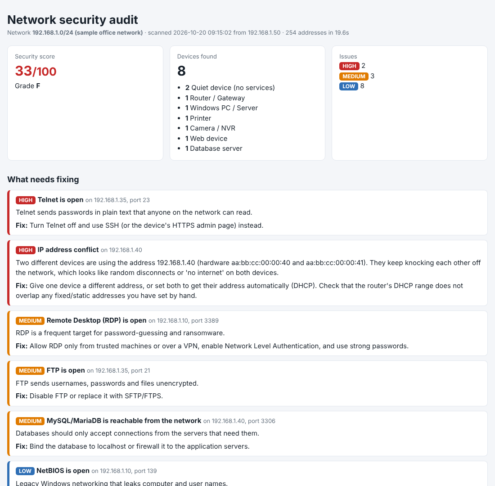

# LAN Auditor

**Find every device on a local network and flag security risks in plain English.**

One command scans an office or home network, works out what each device is (PC, printer,
router, camera, server), checks for risky open services, and produces a clean HTML report
that a business owner can actually understand, with a fix for every problem.


<sub>Report from a sample small-office network. See the full page: [docs/sample-report.html](docs/sample-report.html).</sub>

## Why

Small businesses in the Gulf often run on a router, a few PCs, a printer, cameras and a POS
system, set up once and never checked again. IT technicians walking into these sites need a
fast answer to two questions: *what is on this network?* and *what is dangerous?* Tools like
Nmap answer the first, but their output is written for specialists. LAN Auditor answers both,
in language the client can read, and needs nothing installed except Python.

## Features

- **Finds devices** with TCP connection probes and ping, then reads the ARP cache to catch devices whose
  firewall blocks everything (like Windows PCs). No administrator rights, no Npcap/WinPcap.
- **Checks 27 common ports** (or any list you give) in parallel. A /24 network takes about 10–20 seconds.
- **Identifies devices** from open ports, service banners and hostnames: Windows PCs, printers,
  routers, Wi-Fi extenders and access points, cameras/NVRs, Linux servers, databases and IoT devices.
  Spots devices that use two addresses (same MAC).
- **Flags security risks** with severity and a fix: Telnet, FTP, exposed RDP/VNC, databases open to
  the network, SMB/NetBIOS, SNMP, web admin pages without HTTPS, outdated SSH v1 and more.
- **Detects IP address conflicts** — two devices set to the same address, the classic cause of
  "it keeps randomly disconnecting". The scanner reads the ARP cache several times and flags any
  address whose hardware (MAC) keeps changing, with a plain-English fix. No special privileges needed.
- **Scores the network** from 0 to 100 with a letter grade.
- **Reports** as a terminal table, JSON for other tools, and a single-file HTML report (dark mode
  included) that you can email to a client.
- **Reads MAC addresses** from the ARP cache. Add the free IEEE `oui.txt` with `--oui` to show device makers.
- **Safe by default:** refuses public internet addresses and anything bigger than a /22.
- **Standard library only.** Runs on Windows, macOS and Linux with Python 3.9+, tested on all
  three by GitHub Actions.

## Quick start

```bash
pip install git+https://github.com/omar-aldaihani/lan-auditor.git

lanaudit                                   # scan this computer's network (/24)
lanaudit --html report.html --open         # ...and open the HTML report
lanaudit -t 192.168.1.0/24                 # a specific network
lanaudit -t 192.168.1.10-50 -p 22,80,443   # a range, chosen ports
lanaudit --json scan.json                  # save results for later
lanaudit --from-json scan.json --html r.html   # rebuild a report without rescanning
```

On Windows without installing: download the repo and double-click **`Scan my network.bat`**.

Example terminal output (sample network):

```
LAN Auditor 1.0.0  -  192.168.1.0/24
Scanned 254 addresses in 18.4s, found 10 devices. Security score 40/100 (grade D).

IP              TYPE                      OPEN PORTS           ISSUES
------------------------------------------------------------------------------
192.168.1.1     Router / Gateway          53,80,443            none
192.168.1.10    Windows PC / Server       135,139,445,3389     MEDIUM, LOW, LOW
192.168.1.20    Printer                   80,515,631,9100      LOW, LOW
192.168.1.30    Camera / NVR              80,554               LOW, LOW
192.168.1.35    Web device                21,23,80             HIGH, MEDIUM, LOW
...
Findings (most serious first):
  [HIGH] 192.168.1.35 port 23: Telnet is open
         Fix: Turn Telnet off and use SSH (or the device's HTTPS admin page) instead.
```

The exit code is `1` when a high-severity issue is found, so it can be used in scripts and scheduled checks.

## How it works

```
parse target ─► discover hosts ─► scan ports ─► grab banners ─► sample ARP cache
 (safety checks)  (TCP + ping,      (thread pool)  (SSH/FTP/HTTP    (MACs + IP-conflict
                   128 threads)                     headers)         detection)
       └──────────────────────────────► analyse ──► text / JSON / HTML report
                               (device type, findings, score)
```

| Module | Job |
| --- | --- |
| `lanaudit/scanner.py` | Target parsing and safety limits, host discovery, port scanning, banners, ARP parsing (Windows/macOS/Linux formats), repeated ARP sampling for IP-conflict detection, OUI lookup |
| `lanaudit/analysis.py` | Device classification rules, security findings with fixes, score and grade. All rules are plain data, easy to extend |
| `lanaudit/report.py` | Terminal table, JSON and the self-contained HTML report (all values HTML-escaped) |
| `lanaudit/cli.py` | Command-line interface |

## Tests

```bash
python -m unittest discover -s tests -v
```

31 tests start real TCP and HTTP servers on `127.0.0.1` to check discovery, port scanning and
banner grabbing, and cover target safety rules, ARP parsing, IP-conflict detection, device
classification, every finding, scoring, HTML escaping and the CLI. CI runs them on Windows,
macOS and Linux.

## Limitations

- Checks common TCP ports only. A clean result does not prove a device is secure.
- Firewalled devices are found through ARP only when they are on the same network segment, and
  their type can't be identified.
- IP-conflict detection catches a conflict that is active during the scan; an intermittent one may
  need a second run while it is happening.
- Device types are educated guesses from ports and banners.
- It does not test passwords, change anything, or try to exploit anything. It only reports what it can see.

## Responsible use

Only scan networks that you own or that you have written permission to test. Scanning other
people's networks may be illegal. LAN Auditor refuses public IP addresses for this reason.

## Author

Built by [Omar Aldaihani](https://github.com/omar-aldaihani), computer engineering graduate
(University of Hartford) and freelance IT technician in Kuwait. See also
[IT Check](https://github.com/omar-aldaihani/it-support-toolkit) and
[Kuwait Job Search](https://github.com/omar-aldaihani/kuwait-job-search).

## License

MIT
